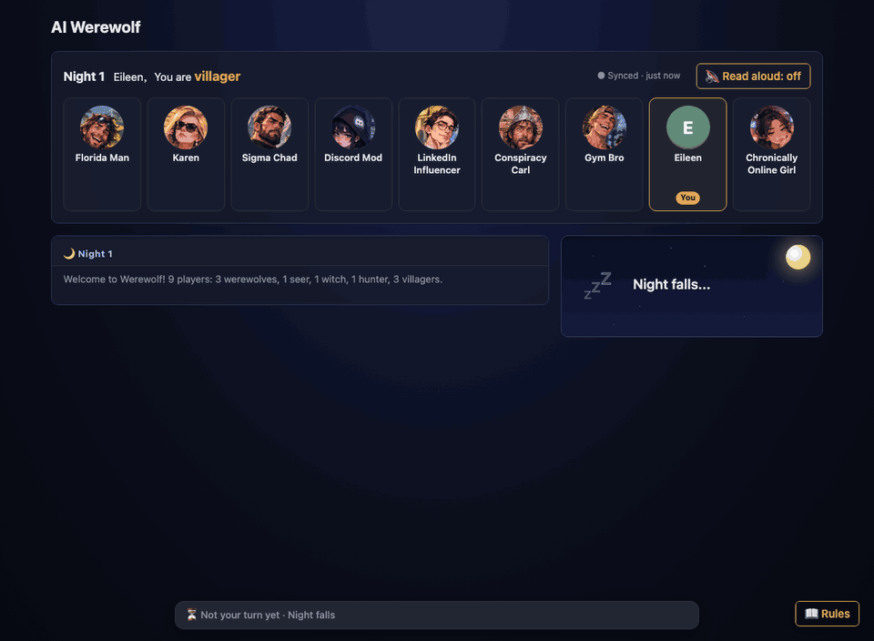
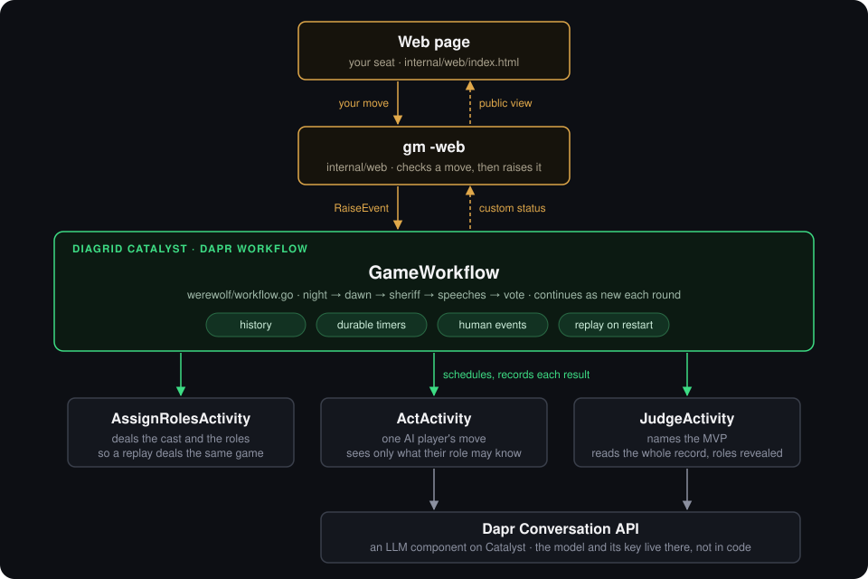

<div align="center">

# 🐺 AI Werewolf

**9 AI agents. 3 werewolves. 1 shared brain cell.**

A social deduction game powered by [Dapr Workflow](https://docs.dapr.io/developing-applications/building-blocks/workflow/) and [Diagrid Catalyst](https://www.diagrid.io/catalyst)

   

</div>



<p align="center"><sub>The real seer was voted out. He turned it into a leadership lesson.</sub></p>

## A perfectly normal day in the village

Put nine LLM agents in a village, give three of them permission to murder, and tell everyone else to trust the process. They lie, form alliances, hold grudges, and confidently vote out the only person who knows what's going on. Or take a seat yourself, and bring up to eight friends. The AI doesn't know you're human, and won't go easy on you.

The fake seer wins the badge, the real seer gets voted out on the sheriff's one and a half votes, and the witch poisons Florida Man on a theory. The storyline comes from a real game, where the real seer's last words were "Leadership lesson: consensus isn't verification." The replay is scripted, on the real page, to fit it in under a minute.

Post-game analysis:

- Real seer: dead.
- Werewolves: thriving.
- Village: confidently incorrect.
- LinkedIn Influencer: already drafting a post about it.

The game master's terminal is a god's-eye feed of the chaos: every public accusation, every private thought, and every read that shifts over the game.

## Meet the suspects

- **Karen**: wants to speak to the manager. Whoever accused her or voted for her is her top suspect, and gets her vote at the first chance.
- **LinkedIn Influencer**: every speech is a post, every post ends in "Agree?". Backs whoever the room likes and switches sides the moment it does. Calls it agility.
- **Florida Man**: pitches one unhinged scheme a day, usually involving an alligator. Would rather vote wrong than vote safe.
- **华妃**：贱人就是矫情。谁投过本宫，本宫就投回去，除非你拿出铁证。
- **安陵容**：姐姐说这话，是在怀疑我吗？当面不吵，三轮之后悄悄投你。
- **摸鱼王**：先对齐一下颗粒度。谁发言最长就怀疑谁，投票跟人多的一边，好早点下班。

<details>
<summary>The rest of the village</summary>

**English**

- **Sigma Chad**: if the table agrees on something, he doesn't. Once he has a read, he keeps it.
- **Discord Mod**: finally has authority outside a Discord server. Keeps a public strike count and votes for whoever has the most.
- **Conspiracy Carl**: ties three players together through one theory a day. Every death only proves how deep it goes.
- **Gym Bro**: follows whoever sounds most confident, bro. Doubts anyone who hesitates.
- **NPC Steve**: "Okay." Votes with the table, unless you plainly said one thing and did another.
- **Chronically Online Girl**: reads vibes, calls out red flags, roasts every LinkedIn post.

**中文**（一局坐四对冤家和一个独行侠）

- **柯南**：真相只有一个。只认证据，可惜派大星不认。
- **派大星**：所以狼人是我们中间的一个人吗？凭直觉投票，推理说服不了他。
- **龙傲天**：早就看穿了一切。第一天认定的狼，第三天还是那只。
- **皇后**：本宫只是觉得，此事未免太过巧合。从不点名，等别人冲完再收票。
- **闪电**：我……觉……得……反应永远慢一拍，今天在回应昨天的事。
- **卡皮巴拉 / 懒羊羊 / 光头强**：一局坐一个。都行，你开心就好；困……；我都说了我不是狼！你们是不是有病啊！

</details>

Each character also has a rival at the table, so the bickering is built in.

## The game master is immortal. Unfortunately.

The whole game runs as a durable Dapr Workflow on Diagrid Catalyst, because even terrible decisions deserve durable execution. Kill the game master in the middle of a heated accusation. Restart it. The village picks up right where it left off.

- No lost game state.
- No repeated LLM calls.
- No forgotten betrayals.
- Karen is still mad at you.

The process may die. The drama persists. [Try it yourself](#6-try-killing-the-game-master).

## Why this is not just nine chatbots taking turns



- **The workflow is the game master.** The phases are plain Go code in one Dapr Workflow, which continues as new at the end of each round so its history stays short. Dealing roles, every player's move and the MVP verdict are activities, so their results are written to the workflow history on Catalyst.
- **Secrets stay secret in code.** The workflow holds the whole truth. Before each move it builds that player's view with only what their role entitles them to; a seat has no role field at all, so there is nothing for the prompt to leak.
- **Agents think in parallel where the rules allow.** Everyone votes at once, and the next speaker updates their notes while the current one talks.
- **A person is just another event.** Your seat's move arrives as an external event, with a three-minute timer; if it fires, an AI plays the move for you.
- **Restarts are free.** After a crash the workflow replays its history: finished moves return their recorded answers, no LLM is called twice, and the game carries on from the line it stopped at.

### Inside a real game

Nine AI agents. One durable workflow. Parallel moves, private decisions, and a complete execution history.

[](docs/images/workflow-full.png)

*Click to see the whole final round.*

That is the end of a real game: the five players still alive vote at once, each taking 9 to 23 seconds, so the vote takes as long as the slowest one rather than all five added up. Then come the last words of the player voted out, a pause, and the MVP judge. Earlier in the round, the day's speeches run two at a time: one player speaks while the next one prepares. Earlier rounds are earlier executions of the same workflow instance, since it continues as new each round.

How each part works is in [docs/design.md](docs/design.md).

## What makes it interesting

- **Different personalities. Same terrible judgment.** Characters don't just sound different; they decide differently. Some follow evidence, some follow the crowd, some hold grudges, and Karen revenge-votes whoever voted for her.
- **Enemies by day. Teammates by murder.** Rivals bicker, argue over strategy and accuse each other, but only with real evidence, like anyone else. Two rival werewolves fight in public and over the plan at night, and still play as a team.
- **One fake seer. Zero ethics.** Every game, one wolf runs for sheriff and claims to be the seer, with a fake check, a badge flow and an attack on the real one, and is held to every check they have reported. The pack is secretly dealt how the rest play around them: back the fake seer, or have one more wolf earn the village's trust by siding with the real seer, even against a teammate. They never move as a bloc, because the village reads the votes, but never sit a vote out together either; they change course when a play fails, and may kill one of their own at night to bait the witch's antidote.
- **Long-term memory. Short-term grudges.** Everyone keeps notes on who they trust, who they suspect and why. Each player sees only what their role entitles them to: a werewolf their pack, a seer their checks.
- **Hallucinations are not a valid defense.** Voting for someone not at the table, quoting someone who never spoke, or "there is no proof" as a reason all get the answer sent back to try again.
- **Think you're smarter than nine LLMs? Prove it.** From a web page, play in place of any character under your own name. Your role is dealt like anyone's, and if you take more than three minutes over a move, an AI plays it for you.
- **Even murder gets a performance review.** At the end an LLM judge reads the whole record, every role revealed, and names the most valuable player with a reason.
- **Two villages.** English with internet archetypes, or Chinese with meme characters. Roles and seats are random every game.
- **Try it without an API key.** Local mode plays with random players on a SQLite-backed engine. LLM games use Catalyst's Dapr Conversation API.

Jump to the [Quick start](#quick-start-play-with-llms-on-catalyst) for an LLM game, or [Play locally](#play-locally-no-account-needed) to try it without an account.

Trust nobody. Especially the one who says they're the seer.

## Rules

A standard nine-player game: 3 werewolves, a seer, a witch, a hunter and 3 villagers.

- **Night**: the werewolves talk in private and pick who to kill (they may pick one of their own). The witch learns who was killed and may save them or poison someone: each potion works once, at most one per night, and she may only save herself on the first night. The seer checks one player.
- **Dawn**: only who died is announced, not how. A hunter who is out may shoot one player, by day only, unless the witch poisoned him. A hunter killed at night shoots once the deaths are announced, and a hunter voted out shoots after his last words. The shot is not announced either: the host only says who has died.
- **Sheriff**: on Day 1, before the night's deaths are announced, the table elects a sheriff, so whoever died that night still takes part. Each of them decides whether to run; the candidates give a campaign speech, then any of them may withdraw, and those who never ran vote. A candidate who withdraws cannot vote either. If nobody runs, everybody runs, every candidate withdraws, or the vote ties, there is no sheriff. The sheriff speaks last each day and their vote counts 1.5. A sheriff who is out passes the badge to a living player or tears it up. The page marks the sheriff with 🎖️ and shows the 1.5 in the vote card.
- **Day**: everyone speaks once, the sheriff last to call the vote. Then straight to a vote, where anyone may abstain: a tie, or everyone abstaining, means nobody goes. Whoever is voted out gets last words.
- **Winning**: the good side wins when every werewolf is out. The werewolves win when every villager is out, every power role is out, or the living werewolves are at least as many as everyone else, since from then on they control every vote. Then the AI players look back on the game with the roles revealed: who read it right, and who was fooled by whom.

## Quick start: play with LLMs on Catalyst

### Prerequisites

- [Go](https://go.dev/dl/) 1.26 or later
- A [Diagrid Catalyst](https://catalyst.diagrid.io) account
- The [Diagrid CLI](https://docs.diagrid.io/catalyst/references/cli-reference/intro):

  ```bash
  curl -o- https://downloads.diagrid.io/cli/install.sh | bash
  diagrid login
  ```

- An OpenAI API key

### 1. Get the code and build it

```bash
git clone https://github.com/Eileen-Yu/ai-werewolf.git
cd ai-werewolf
go build -o bin/werewolf ./cmd/werewolf
```

### 2. Create a Catalyst project

The game master needs the Workflow API, so create the project with managed workflow turned on:

```bash
diagrid project create werewolf --enable-managed-workflow --wait
```

If you already have a project, turn it on there instead:

```bash
diagrid project update <project> --enable-managed-workflow
```

The commands below use `werewolf` as the project name. Use your own.

### 3. Connect an LLM

Players call the model through the Dapr Conversation API. Create a conversation component named `llm` in the project. The model must be `gpt-6.1-sol` (see [The model](#the-model)):

```bash
diagrid component create llm --project werewolf --type conversation.openai \
  --metadata key=<your OpenAI key> --metadata model=gpt-6.1-sol
```

### 4. Start the game master

```bash
diagrid dev run --project werewolf --id werewolf --approve -- ./bin/werewolf gm -brain llm
```

`dev run` creates the app ID `werewolf` on Catalyst and starts the game master on your machine. Once you see `game master ready (brain: llm)`, you can start a game. This terminal is the live feed.

### 5. Start a game

In another terminal:

```bash
diagrid workflow start GameWorkflow --project werewolf --id werewolf --instance-id game-1 --data '{"lang":"en"}'
```

Leave out `--data` for a game in Chinese. When the game is over, get the result and the execution history:

```bash
diagrid workflow get game-1 --project werewolf --id werewolf
```

### Play a seat yourself, or bring friends

Add `-web :8080` when you start the game master:

```bash
diagrid dev run --project werewolf --id werewolf --approve -- ./bin/werewolf gm -brain llm -web :8080
```

Open <http://localhost:8080>, pick a language and how many people play, from none to all 9, and give each a name and whose seat to take. AI plays the other seats. Alone, you go straight to your seat. With friends, the page lists one private link per person, on this machine's address on your network, so everyone opens theirs on their own phone or computer on the same Wi-Fi. A link only opens its own seat, so nobody sees anyone else's role. The list ends with a spectator link, which shows only what everyone at the table hears; with nobody playing, you go straight to it and watch nine AIs. The page shows every seat at the top: who is out, who holds the badge, who is speaking, which seats people play, and your own role and pack, with everyone's roles once the game is over. Below it, the timeline groups the game by night, dawn, sheriff election and day, sets votes, deaths and the host's results apart from speeches, and stops following new lines while you scroll back. It shows what your seat sees and asks for your move when it is your turn: a speech with who you suspect and, if you like, a role claim, or a pick for a vote, a check, a potion or a shot. While you wait, it shows what the table is doing: the wolves plotting under a night sky, who is speaking, or everyone voting, and for how long. The game master's terminal is still the god's-eye feed, so keep it out of sight while you play.

The page can also talk. Click **🔊 Read aloud** and every new line is spoken, each character in a voice, pitch and pace of their own. On your speaking turns, **🎤 Speak** types what you say into the speech box, where you can fix it before you submit. Both use the browser's own speech support, so nothing goes through the game master; voice input needs Chrome or Edge and microphone access, and Chrome sends the audio to Google to transcribe it.

### 6. Try killing the game master

While a game is running, press Ctrl+C in the game master's terminal, wait a moment, and run the command from step 4 again. The game carries on from where it stopped, and nothing earlier is repeated.

## Play locally (no account needed)

If you would rather not sign up or pay for an API, you can play a game with random players on your machine. The local engine keeps its state in a SQLite file, `werewolf.db`. Open three terminals:

```bash
go run ./cmd/werewolf engine                                   # local workflow engine
go run ./cmd/werewolf gm -engine localhost:4001                # game master; its output is the live feed
go run ./cmd/werewolf start -engine localhost:4001 -lang en    # start a game and wait for the result
```

Killing processes works here too: stop `gm` and start it again, or stop the engine as well and start both again.

To play a seat yourself, add `-web :8080` to the `gm` command and open <http://localhost:8080>; skip the `start` command.

Local mode only has random players. LLM players need the Conversation API that Catalyst provides.

## Configuration

### Game input

The `--data` for `diagrid workflow start` is JSON, and every field is optional:

| Field | Default | Meaning |
|---|---|---|
| `lang` | `"zh"` | `"zh"` for Chinese, `"en"` for English |
| `phaseDelay` | `0` | How long the game waits after the night, the election and each day before going on, so watchers can follow it. It is a durable timer, so it is also a window to kill the gm and watch the game resume. Written in nanoseconds because that is how Go encodes a duration: `2000000000` is 2 seconds |
| `tactic` | dealt at random | Pins the pack's play, to show one off: `"counterclaim"` or `"hook"`. Games from the web page are always dealt one at random, so a person never knows the pack's plan |
| `humans` | none | Seats people: `[{"name":"Eileen","replaces":"Karen","key":"..."}]`, up to 9. Each `key` opens that person's seat on the page. The web page sets this for you, with a random key each |

```bash
diagrid workflow start GameWorkflow --project werewolf --id werewolf --instance-id game-2 \
  --data '{"lang":"en","phaseDelay":2000000000}'
```

### Command line

| Command | Flag | Meaning |
|---|---|---|
| `werewolf gm` | `-brain random\|llm` | Random or LLM players. Default `random` |
| | `-llm-component <name>` | Name of the conversation component. Default `llm` |
| | `-engine <address>` | Use a local engine; leave it out to use Dapr (Catalyst) |
| | `-web <address>` | Serve the page a person plays a seat from, e.g. `:8080`. Default: no page |
| | `-human-timeout <duration>` | How long a person has for a move before an AI plays it. Default `3m` |
| `werewolf start` | `-engine <address>` | As above |
| | `-lang zh\|en` | Language of the game. Default `zh` |
| | `-delay <duration>` | Pause between phases. Default `2s` |
| | `-id <name>` | Game instance ID. Default is generated from the time |
| `werewolf engine` | `-addr <address>` | Address the local engine listens on. Default `localhost:4001` |
| | `-db <file>` | SQLite file for the state. Default `werewolf.db` |

### The model

The players are tuned for OpenAI's `gpt-6.1-sol`, and that is the model to use. Every request is sent with a temperature of 1, the only value `gpt-6.1-sol` accepts. A game makes roughly 100 to 150 LLM calls.

If you set the model name wrong, `component update` fixes it. It replaces all the metadata, so pass the key again:

```bash
diagrid component update llm --project werewolf \
  --metadata key=<your OpenAI key> --metadata model=gpt-6.1-sol
```

## FAQ

**The feed shows `connection reset by peer` or `reconnecting work item listener stream`.**
The connection dropped for a moment. The game master reconnects by itself and the game is not affected.

**I changed the code. Can a game in progress carry on?**
If you only changed how players think (`brain/`), yes. If you changed the game master's flow (`werewolf/`), let running games finish or start a new one. Never run two game masters with different code at the same time.

**How do I stop a game?**

```bash
diagrid workflow terminate game-1 --project werewolf --id werewolf
```

## Hacking on it

How the game master works, what each player can see, and how LLM answers are checked are in [docs/design.md](docs/design.md). To run the tests:

```bash
go test ./...
```

## License

[MIT](LICENSE)

*No werewolves were harmed in the making of this README. Several seers were.*
