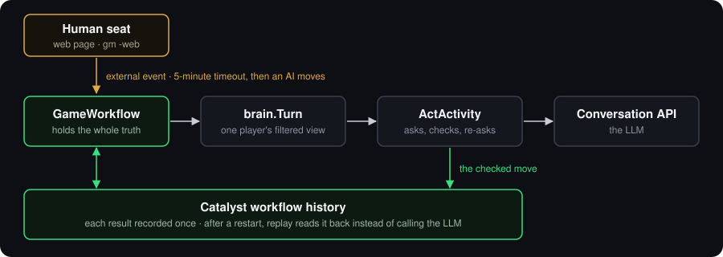

# Design: how to orchestrate nine unreliable AI agents

Nine AI agents walk into a village. Three are lying. Several are confidently wrong. One thinks every disagreement is a leadership opportunity.

The game master has to keep them playing by the rules without telling them who is lying, let them think and vote independently, and survive being killed halfway through an argument. This document explains how. For how to play, see the [README](../README.md).

## The architecture

The game has one source of truth: a durable Dapr Workflow, `GameWorkflow`. It owns the game state and decides what happens next. Activities do everything that is not deterministic: dealing roles, every LLM call, every random pick. Each agent gets a filtered view of the game, keeps its own notes, and hands back a move that the game master checks before applying.



The boundaries that matter:

- **The workflow knows the truth.** Agents only see their own filtered views.
- **Agents may lie about the game.** They may not invent players, votes or speeches.
- **Independent moves run at once.** Speeches stay in order, with the next speaker preparing in parallel.
- **Human moves arrive as external events.** A timeout lets an AI take over.
- **Finished activities survive restarts.** Replay uses recorded results instead of calling the LLM again.

The result is a game where the characters can be unreliable without making the system unreliable.

| Directory | Contents |
|---|---|
| `game/` | The rules: dealing roles, who can see what, counting votes, deciding the winner, and how game words are shown in each language. Plain functions with no Dapr dependency |
| `brain/` | How players think: `random` (free) and `llm` (Dapr Conversation API). The prompts are in `brain/text.go` |
| `werewolf/` | The game master workflow. The host's lines are in `werewolf/text.go` |
| `internal/engine/` | A local workflow engine (durabletask and SQLite), used only for local play and tests |
| `internal/web/` | The page a person plays a seat from, and the JSON API behind it, served by `gm -web` |
| `cmd/werewolf/` | The command line: `engine`, `gm` and `start` |

A game is one workflow instance, and each round, night then day, is one execution of it. `AssignRolesActivity` deals the cast and roles in the first. At the end of a round with no winner, continue-as-new starts a new execution of the same instance, with the same instance ID, a fresh history and the state as its input; once there is a winner, `JudgeActivity` names the MVP, the AI players look back on the game, and the workflow returns the result.

## The game master knows everything. Nobody else does.

**Problem.** An LLM told "you are a villager, don't look at the roles" will look at the roles if they are in its context. A prompt is not a security boundary.

**Decision.** The workflow holds the whole truth in `game.State`. Before every LLM call it builds that player's view, `brain.Turn`, with only what the player is entitled to know. Nobody else's role is ever passed in: the seat type, `brain.Seat`, has no role field at all, so there is nothing for the prompt to leak.

A view has seven parts:

- **Seats and status**: who is alive and who holds the badge. A dead player only shows when they died, or that they were voted out: "died on Night 2", "voted out on Day 2". Whether someone was killed by the wolves, poisoned, saved or shot is never announced; only the player who used the power is told.
- **Your secrets**: your role, your fellow wolves, the wolves' night talk and plan, that the wolves' victim survived (only the witch can have saved them, so the wolves know not to accuse that player), your check results, and what the witch knows about tonight's victim and her potions. These are the only facts that are certain.
- **Your notes**: the player's own memory (see below).
- **Your recent private thoughts**: the `thinking` from the last 3 moves. Older reasoning should already be in the notes.
- **Claims on the table**: claims taken from public speech, each marked unverified. If Mia claims she checked Ruby and Ruby is good, other players get only "Mia claims: seer, Ruby: good (unverified)". This is where the wolves have room to deceive.
- **Votes**: every vote so far, for sheriff and to vote someone out, listed by vote and by player, with the sheriff's 1.5 marked. Players are told to read the votes before the speeches, since a vote is harder to fake than a speech.
- **Public record**: what everyone saw, and the only history a player may quote.

Right next to the task, the prompt lists again what this player knows for certain, and says it wins over anyone's claim. The same facts are under "Your secrets", but that is too far away: without the reminder, a seer who checked someone as good would go on to suspect them by day. When speaking, a player is also told who has already spoken this round and who has not.

The host only ever states what everyone at the table could see. The page a person plays from is filtered the same way (see [A human enters the village](#a-human-enters-the-village)).

## How nine AI agents think

### One answer, in a fixed order

The system prompt asks a player to think in a fixed order, and each step is a field of the JSON answer:

1. `observations`: what happened since their last move. Concrete events only.
2. `notes.pits`, for good players: one to three whole packs that could explain the game, the likeliest first, each with what supports it, what does not fit and how likely it is.
3. `notes.beliefs`: each read updated against the old notes. Only new evidence changes a read: "a flat speech" or "feels suspicious" is not evidence.
4. `notes.strategy`: what they plan to do next. Before a move that matters, a fake claim, a vote they lead, a night kill or a potion, they first look at it through the one or two players it matters most to: who that player has shown they believe, how the move looks in that version of the game, and whether it could backfire.
5. `thinking` and the move: `speech` is what they say out loud and `target` is who they pick. A day speech also gives `suspect` (who they suspect most, or nobody) and `claim` (`{"role", "target", "result"}`, or null). A wolf may lie.

That fourth step is there because a player otherwise judges a move by the truth only they know. A wolf who backs the real seer to look good fools only the players who believe that seer; to one who believes the fake, he looks like the real seer's fellow wolf, and a public threat aimed at someone else does not make him safe. The step asks for one or two players, not a belief for every seat about every other, and what they have shown, not what they think: wolves and hidden power roles act too. It is prompt alone: what they write lands in `strategy`, so it adds no field and no call.

The prompt also lists the places where rules combine in ways models get wrong. A seer checking someone as good and the witch saving that same person back each other up rather than contradict. When someone reports a check on you, you know your own role, so a right one is strong evidence they are the real seer. The player killed at night is not necessarily good, since wolves can kill their own. "There is no proof" is not evidence, since no claim can be proven on the spot.

### Nine separate memories

Every player keeps notes: `beliefs` (werewolf, good or unsure about each player, with a list of evidence) and `strategy`. Every move hands back notes, which update the old ones: a belief given replaces the old one about that player, a player left out keeps theirs, and an empty strategy keeps the old one.

**Problem.** Werewolf is a logic game under the talk. A good player who only holds one read per player thinks "X is a wolf because of Y" and gets stuck on one suspicion, when the real question is which three players explain every death, claim and vote together. And a wolf's `beliefs` were wasted: every non-wolf is good, which the wolf already knows.

**Decision.** Good players also keep `pits`: up to three whole packs, the dead included, written from who backs which seer and how people voted first, then refined by the speeches. Two seers counter-claiming give two readings, and each gets a pit. A new list replaces the old one, and a turn that writes none keeps it. The game master sends back a pit that names someone not at the table, has more players than the game has wolves, or counts the player themselves a wolf; if the answer still fails, the old pits stay. A wolf writes no pits. Instead a wolf's `beliefs` say whether each good player seems to be a power role, a villager or unsure, since the wolves win by wiping out either side, and no role is shown when a player dies.

**Tradeoff.** A longer answer on every move. The pits are a guess the player writes, not a fact, and they come back under the notes, which are labelled as the player's own.

**Problem.** Most of a move's time is the model rewriting its notes, not the speech. Speeches have to go one at a time, since each speaker answers the last, so a day of nine speeches waits on nine full note rewrites in a row.

**Decision.** While one player speaks, the next one has a `prepare` turn: no speech, only their notes, brought up to date with the record as it stands, which does not yet hold the speech being given. Their own turn is then marked `Prepared`. It still sees the whole record, the latest speech included, but is asked to take in only what came after its notes and to write only the beliefs that changed.

**Tradeoff.** About one extra LLM call per speaker. In return the wait for a speech is roughly the longer of the two turns, not both added up, and the speaker's own turn is short. Only the next speaker prepares, and a human seat never does.

The god's-eye feed in the game master's terminal prints each player's observations, changed reads and changed pits, such as "rethinks: NPC Steve unsure→werewolf, because: …" and "works out the pack: pit 1 (high): Karen, Gym Bro", so you can watch a read build up.

### Personalities with consequences

Each character has four parts:

- `Persona`: how they talk.
- `Habit`: how they lean when they decide, such as who they suspect, what changes their mind and how they vote.
- `Rivalry`: who they clash with, and how.
- `Badge`: how keen they are to run for sheriff.

**Problem.** Nine personas on their own play like one model in nine voices: everyone reasons the same careful way and only the wording differs.

**Decision.** The habit is given as a lean, not a rule, and it is repeated right where the player acts, not only in the system prompt. The shared rules also say a player is not a neutral moderator: finding wolves beats correcting someone's wording, and a character may be emotional, stubborn or plainly wrong when that fits them, as long as what they cite really happened. When the evidence and the votes are clear, the situation wins, so personality shows mostly in how they talk and in close calls.

Only the rivalry names anyone, and a rivalry shapes how two players talk to each other, never which side either thinks the other is on. Personality decides how they fight; their side decides who they fight for. So one pair can play three stories: two good players suspect each other and may vote each other out by mistake; a wolf and a good player are real enemies; two wolves bicker in public and over the plan at night, but put the pack first and never give each other away out of spite.

The badge lean runs from Discord Mod and 华妃, who almost always run, to NPC Steve and 摸鱼王, who almost never do. It is only in the `run` turn, and the player's role and the pack's plan can override it. Like the habit, it names nobody.

The English cast is exactly nine, so everyone is always seated. The Chinese cast is eleven: four rival pairs, seated together or not at all, and three loners. A game seats either all four pairs and one loner, or three pairs and all three loners; the first happens in 3 games out of 11, which gives every character the same 9 in 11 chance of a seat. A rivalry only names players sure to be at the table. The draw happens in the role-dealing activity, so a replay gets the same cast.

### Two sides, two playbooks

**Problem.** An earlier version made every pack fake the seer and dealt it one of three tactics at random. The good players were told so too: wolves fake almost every game, they love to claim first, a seer's werewolf report on the night's victim marks the fake. So a good player could beat the implementation rather than the wolves: the first claimant was suspect by default, the faker lost the badge on Day 1, and every pack sounded alike. The witch was likewise told to use the antidote early, so she saved on almost every first night. Before that, packs left to choose often all stayed out and lost without trying.

**Decision.** Nothing is dealt, and nothing about how the pack tends to play is told to anyone else. Each night the wolves choose their play from a menu only they see (`packPlays` in `brain/text.go`), each option with its cost: a single fake, a double claim where the two may oppose each other, or no fake at all, with the other wolves charging, hooking or lying deep, and the faker reporting a good check, a werewolf or a good check on a teammate. They choose by the cast, the seats, the night chat and, after the first night, the deaths, claims and votes. No fake is described as an active play, catching good players' slips by day, so choosing it does not mean going quiet. The plan names zero to two `fakers` and optionally a `hook`; the game master still holds a named faker to their claim, and a wolf who has claimed seer may never take it back. The plan writer is told to take up a teammate's concrete proposal from the night chat, or say in the plan why not; without that the AI leader ignored a person's proposals.

The good players keep how to weigh a claim, never a prior on it: compare the checks, the reasons, the badge flows and the votes; claiming first or later proves nothing; a lone claim is not proven true. A sloppy argument is not proof either: before calling someone a wolf, a player also considers a weak good player, a hooking wolf and a side taken for now. The witch is told what each choice costs and that on the first night both are sound: one antidote, a self-save on the first night only, the victim's name but not their role, a peaceful night telling the wolves.

**Tradeoff.** Left free, the wolves may pick a weak play for the cards, and early versions showed they could all stay out. The menu and its costs are the guard against that, not a rule; if they drift back to passivity, the fix is a better description of what each play buys, not forcing one. Win rates were not tuned: no side is made stronger or weaker to even them out. `werewolf stats` plays many games and counts how the plays and the outcomes actually fall, so a pattern the players exploit, such as the wolves always faking or the witch always saving, shows up as a number.

**Wiping out a side.** The pack wins once all three power roles or all three villagers are out, or once the wolves alive are at least as many as everyone else. At night the wolves get a count the game master works out, which only they see: who is alive on each side, the good players already out, whose roles nobody was shown, and which living good players this wolf reads as power roles or villagers. The night chat settles which side to go for first, and the plan names it as `edge`, `power role` or `villager`; the plan line and the next day's turns carry it. Wolves are told to count before killing a power role, since a believed seer killed at night has their checks confirmed by it, that wiping out the villagers is faster when the power roles hide well, and that a wolf the pack gives up, by turning on a teammate, sending a faker or a self-kill, should buy cover or a faster read on the power roles. A person writing the plan may leave the edge out.

The rest of the two playbooks follows these principles. The exact wording, in both languages, is in `brain/text.go`.

- **The pack hides in the votes, not just the speeches.** The good side is told to read the votes across days, so the wolves are told how not to look like a bloc: no piling on together when they drive a push, no public defence of a teammate, and a teammate sacrificed only for a concrete reason. Splitting is not dodging, though. When good players are already voting out a good player, the wolves join in, and they never abstain together: a pack that sits out a vote everyone else takes a side on gives itself away. An earlier rule, at most two wolves on any one target, did exactly that, with all three wolves abstaining on a lopsided vote. Both sides get the same model of what a pack looks like, from opposite ends.
- **Following the crowd is a tell, not cover.** Repeating others' reasons and riding the room's push looks like a player who is not trying to win. Wolves are told to bring a reason of their own each time they take a side, and to go against the room when a good player would; good players are told that, in a one-sided swing, whoever only echoes is where to look.
- **A vote is a team decision, not a personal opinion.** Good players are told to join the likeliest suspect rather than split, and to break a repeated tie, since the wolves win by waiting. But they must agree with a reason of their own, and the prompt warns that a fast one-sided swing is exactly where wolves hide.
- **Read a speech from the speaker's seat.** Every player is told to judge a speech from where it was made: the speaking order, what had been said before it, who was still to speak, and what the speaker's claimed role could know then. A good player pressing a seer who gave no badge flow, from the middle of the campaign, is probing the table, not giving themselves away.
- **Read a suspect both ways before acting on them.** Before a good player suspects, votes for, shoots or poisons someone, they write one sentence for the wolf reading and one for the good reading, and act only if the wolf reading clearly fits better. They are given the usual signs each way (wanting the badge and inviting checks on one side; echoing, turning with the room and abstaining on a vote that mattered on the other), and told that wolves fake the good signs, so to ask what the move gains each side. Wolves skip this, since they know.

The random brain keeps its wolves off teammates while it has anyone else to pick, since a sacrifice is a judgement and a random pick is not one.

## Making nine LLMs play by the rules

**The line.** Lying about the game is legal: a wolf may claim any role and report any check, as long as they do not contradict their own earlier claims. Making things up about the table is not: a player who is not seated, a vote that is not allowed, a speech nobody gave.

So the game master checks every answer. If it is not valid, all the problems are sent back together and the player answers again, up to 2 more times.

- `target` and `suspect` must be on the list given; for example, you cannot vote for yourself.
- `claim` may only claim seer, witch, hunter or villager. Anyone it names must be at the table, and a seer's result must be good or werewolf. Someone who has claimed seer cannot then claim anything else, and cannot report a check they already gave the other way round. A villager claim may still give way to a power role coming out, as at a real table.
- Notes may not name anyone not at the table, and a read must be werewolf, good or unsure.
- The wolf plan: tomorrow's vote target must be a living good player who is not tonight's victim. Every plan names one or two wolves as fakers, two for `double_claim`, who must then claim seer in their campaign or speech that day; the hook names another wolf as the hook. Only the first night's plan must name them, so the pack can change course once its fakers are out. The first night's victim may not be a good player sitting next to a faker, the last seat counting as next to the first: the good side would read the death and the claim together. On Night 1 the prompt also lists the good players and the targets in random order, not seat order, because with nothing to tell them apart the model killed whoever was listed first.
- No speech, night talk included, may quote someone who has never spoken in public ("said", "mentioned", "'s speech"), and nobody may say what someone still waiting for their turn "just" said. On Night 1 the prompt says outright that nobody has spoken.
- Day speeches and last words may not use "no evidence", "no proof" or "nobody else confirmed it" as a reason: that is true of every claim.
- A speech may not refer to the speaker by their own name.

Some slips are not worth a re-ask, so they are repaired first:

- A name with a comment after it ("Ruby (she is the most suspicious)"), or "no shot" or "pass" for declining.
- A belief about oneself: dropped.
- A `claim` role written as `"null"` or "none": treated as no claim.
- JSON read leniently: a `claim` written as a string, evidence written as one sentence, a missing or extra comma, or a stray early `}`.

If an answer is still invalid after the re-asks, the pick counts as a pass, and invalid claims and note entries are dropped. A problem only with the content of a speech is logged, and the speech still counts. A bad answer can cost a player their move; it can never stall the game.

Every request is sent with a temperature of 1, the only value `gpt-6.1-sol` accepts. It has to be sent: left out, Dapr's OpenAI component sends 0.

## Orchestrating the chaos

A round is mostly waiting on LLMs, so the workflow runs every move at once that the rules let it, and keeps in order only what has to be.

| Phase | At once | In order, and why |
|---|---|---|
| Night | The seer's check runs alongside the wolves, since it needs nothing they decide | The wolves talk in turn, the next one preparing; then the plan; then the witch, who has to be told the victim |
| Sheriff | Everyone decides whether to run; then every candidate but the seer decides whether to withdraw; then the sheriff vote | Campaign speeches, in seat order, the next one preparing |
| Day | Every vote | Speeches, each answering the last, the next one preparing, the sheriff last; the vote straight after |
| A death | | A player voted out gives last words; then a dead sheriff passes the badge; then a dead hunter shoots. A sheriff the hunter shoots passes the badge in turn |

A durable timer (`phaseDelay`) pauses between phases, so watchers can follow, and the workflow's custom status says what the table is waiting on (`View.Now`) for the page.

### The sheriff

The election runs once, on Day 1, before the first night's deaths are announced, as at a real table: whoever died that night runs and votes like anyone, and a sheriff among them passes the badge as soon as the deaths are out. `night` returns its deaths and `daybreak` announces them, after the election on Day 1 and straight away after any other night. It is simpler than the table game in one way: candidates may withdraw only once, together, after every campaign speech. Those who never ran vote; a candidate does not, even one who withdrew. A lone candidate left wins without a vote, and the host says so. A tie goes to a sheriff PK (`table.sheriffVote`), as a tie to exile does: the tied candidates give another `campaign` speech each, in seat order, told by the host that it is a PK, and the same voters cast another `sheriff_vote` between them. A PK that ties goes to another between the newly tied, up to `MaxPK` (3). No candidates, everyone a candidate, everyone withdrawing, everyone abstaining, or the last PK tying all mean no sheriff.

Everyone decides whether to run, the seer included, who is told the badge pays most and to give a badge flow in the campaign: who they check next and who gets the badge if they fall. A wolf the plan names as a faker is offered only their own name, since the claim is made in the campaign, and counts as running whatever their brain answers. A wolf a person plays is never sent: the plan is advice to them, not a rule. Everyone else's decision comes from their role, their badge lean and what they mean to do; the `run` instruction adds only that running is not just for power roles and that the more who run, the fewer are left to vote. Every candidate may withdraw after the campaign, the seer too.

The sheriff speaks last every day: the speaking order starts at the seat after them. Theirs is the closing speech that calls the vote, so the vote follows it at once; there is no second time round the table. `game.Tally` counts in half votes, 3 for the sheriff and 2 for anyone else, so the sheriff breaks a tie but cannot outvote two players. When the sheriff is out and the game is not over, they get a `badge` turn: a living player, or `pass` to tear the badge up. A night death passes it at dawn; a day exile after their last words. Either way that comes before a hunter's shot, and a sheriff the hunter shoots passes it on in turn.

A tied vote goes to a PK (`table.settle`). The tied players give a `pk_speech` each, in today's speaking order, and everyone else casts a `pk_vote` between them or abstains; those in the PK do not vote, and a sheriff's vote still counts one and a half. A PK that ties goes to another between the newly tied, up to `MaxPK` (3), so a table that keeps splitting cannot stall the game and run up LLM calls; if the last one ties too, nobody goes. Everyone abstaining, or everyone alive being in the PK and so nobody left to vote, also sends nobody out. Each PK vote is its own ballot, numbered by `game.Ballot.PK`, so the prompt's vote record and the page tell it from the day's vote; a sheriff PK's ballot is marked `Election` as well.

### The MVP

When the game is over, `JudgeActivity` names an MVP. The LLM judge is sent the whole record with every role revealed and night secrets included, but not anyone's private thinking, and asked for a name and a reason that cites what happened. If it fails, names someone not at the table, or the brain cannot judge, `brain.Rules` picks one: from the winning side, a survivor before the dead, and the seer, witch and hunter before the rest.

### Looking back

After the MVP, every AI player, out or not, takes one `aftermath` turn in seat order: the roles are on the record by then, so each holds their own notes up to the truth. Their thinking first keeps apart what they knew then, what they believed, what the others showed they believed and what only the reveal told them, so a failed play is seen for what it looked like to the people it was meant to fool. Why someone else did something is only a guess unless they said so: it is put as one, or asked. The speech is one reaction in character, and not the one those before them had: insisting they were right, blaming a teammate, mocking the winners, crediting a move, still not getting it, or asking someone why. It is the chat a real table has before it breaks up, and the moment the players' notes, otherwise private, pay off for the audience. A person at the table says what they like in person, so they get no turn. The judge has already been sent the record, so nothing said here sways the MVP.

## A human enters the village

Up to nine people can sit at one table. `game.SeatHumans` puts each in the seat of the character they picked, in the role-dealing activity, before roles are dealt. `game.Cast` always seats the characters picked, so only those seats change hands. In Chinese that has one limit: a table seats every rival pair and one loner, or three pairs and every loner, so two loners and someone from every pair cannot all sit down, and the page says so before the game starts (`game.CheckPeople`). A rivalry that names a character who left is dropped, since nobody by that name is at the table. Each seat is marked `Human`, with a plain persona for the AI that covers a move the person runs out of time on.

**Decision.** A person is one more kind of move, not a separate code path. Every move goes through `table.act`. For an AI it calls `ActActivity`; for a human seat it waits for an external event named `move-<round>-<n>`, with a five-minute timeout. If the event comes, the move goes through the same `settle` as an AI's answer, so a bad pick still counts as a pass. If the timeout fires, the person is told privately and `ActActivity` plays the move. Votes are asked of everyone at once, and waiting on each person is one more task among them.

The page cannot read the workflow's state, so the workflow publishes a board as its custom status, in every game, with or without people: the table as everyone sees it, the record without thinking, with who may see each line, and each person's own seat (role, pack, pending move). Each event is stamped with its stage (night, dawn, sheriff election, day, the end), and the host's key announcements with their kind (a death, a vote count, a result), so the page can group and mark the timeline without parsing the host's words. Both are plain labels on the record; nothing in the game reads them. The record is kept once rather than once per person, because the status is rewritten on every move. `Now` says what the table is waiting on, people's moves included, but only what anyone at a real table could tell: night moves are "the wolves" or "the night", with the seer's check hidden among them, and a hunter's shot is "the host is waiting", since naming it would give the hunter away. The status is set again on every run of the workflow, replays included.

**Tradeoff.** The board holds every person's secrets, so the page is never given it. `gm` cuts one person's `werewolf.View` from it (`werewolf.ReadView`), filtering the record with `VisibleTo` exactly as for an AI player. Which view is chosen by the `?seat=` key in the person's link, a random key the page made when the game started and the workflow keeps in its input. A key that opens no seat gets nothing. A link with no key at all is a spectator's: the public table and the lines everyone heard, with no role, pack or move, so it gives away no more than sitting in the room would. This is enough between friends on one Wi-Fi; playing over the internet would need real sign-in.

Each page polls its view. A move is posted to `gm` with the person's key, checked against that seat's pending turn (`web.Check`) so the person can be told and try again, and raised as the event. `web.Check` only asks what a form can get wrong; style rules the AI players are held to, like never saying your own name, are not a person's business. Moves asked of several people at once are taken by the workflow in seat order, so a vote cast early would still show as pending until the people before it answer; `gm` remembers the moves it has sent and stops asking for them.

The page tells apart what it can know: the AI the table waits on is thinking, the line being read aloud is someone speaking, and the two are rarely the same player, since the next speech is written while the last is still being read. It also says how it stands with `gm`: in step, with the time of the last poll that worked; reconnecting; unavailable after a minute without an answer; or gone, when `gm` no longer knows the game.

### Summaries of speeches

**Decision.** Every public speech by an AI (a day speech, a campaign or PK speech, or last words), however short, gets a one-line summary, written by a second, separate LLM call that is given only the speaker's name and the speech (`brain.summaryPrompt`). It cannot give away a secret, because it is never told one. The summary rides on the `Action` and the event, the page shows it under the speech marked as a summary rather than the character's words, open on the latest three speeches and on the one being read aloud and folded to a line on older ones, and no prompt ever shows it (`Event.Said` leaves it out), so players read each other's words, not a recap. A person's move carries none; a wolf chat line, private, keeps none.

**Tradeoff.** One more small LLM call per speech, made in the same activity, so the speech lands a little later. A failed call is asked once more; only when both fail does the speech go without a summary. A speech still invalid after every re-ask is played as it stands and is summarized like any other. The speech reaches the page with its summary already on it: the page draws a line once, and the game often waits on the next speaker's preparation right after a speech, so a summary added a moment later would never be shown.

### Revealing a vote

**Decision.** A vote is revealed on the page, never staged in the workflow. The workflow takes every vote at once and puts the ballot on the record, with the count and the announcement of the outcome, in one step, so the page is never shown a vote half cast and nothing waits for an animation. `werewolf.voteResults` turns each ballot into a `VoteResult` for the view: every vote with its weight, the totals by `game.Totals` (the count `game.Tally` decides with, so the two cannot disagree), the outcome (exiled, elected, a tie with who tied, a tie that goes to a PK, everyone abstaining), and what each voter did in the vote before: for a day's vote the day before, for a PK the vote that tied. A PK's result also names who stood in it. The sheriff election is recorded as it ends (`game.Election`): who stood, who withdrew, and how it ended, including the four ways that never come to a vote. The page only animates what it is given: each vote lands in turn, the bars grow out of every vote cast and the rows keep the order of the first vote, so neither gives the outcome away before it is shown.

**Tradeoff.** Only a result that arrives while the page is open is animated. One already there on load, after a refresh or a reconnect, is just listed, with a replay button, so a reload never plays an old vote as news. The timeline below still shows the host's count and the death as soon as they happen; the reveal blurs the page behind it rather than holding the timeline back. A reader can skip it, and one who prefers less motion gets the final state at once.

## Kill the process, keep the game

Random numbers and LLM calls only happen inside activities, so the workflow itself is deterministic. After a restart it replays its history, and activities that already finished return their recorded result instead of calling the LLM again. A killed game carries on from the line it stopped at.

**Problem.** A game is hundreds of activities, and a replay re-reads the whole history.

**Decision.** At the end of each round the workflow continues as new. That is not a new workflow instance: it is a new execution within the same instance, with the same instance ID, whose history starts empty and whose input is the game state.

**Tradeoff.** The history stays one round long, so replays stay fast, but the Catalyst workflow view only shows the current execution, that is, the current round. Anything a later round needs has to be in the state, since the earlier history is gone.

Never connect two `gm` processes with different code to the same app ID. Swapping `gm` mid-game is safe if only `brain/` changed. If the workflow code in `werewolf/` changed, for example the order of activities, a game in progress may no longer replay; start a new one.

## Two languages, one set of rules

The language is set when roles are dealt, stored in the state and kept for every round, so one `gm` can run Chinese and English games side by side. The game's own words (roles, sides, phases, pass and nobody) are always stored in English, and the rules only compare those values. The language decides how they are shown and which words an answer may use: a Chinese game still holds `werewolf`, `good` and `pass`, and a Chinese answer is read back into the English word. All player-facing text is in `brain/text.go` and `werewolf/text.go`, one copy per language; the logic is shared. An unknown language fails the workflow.

## Testing the impossible

The hardest bugs in a werewolf game aren't crashes. They're things the players were never supposed to know.

```bash
go test ./...
```

`werewolf/workflow_test.go` runs an in-memory engine in the test process and plays 10 full games with random players, then scripted cases for what random games rarely hit:

- **Crash recovery**: the game master worker is killed mid-game and a new one takes over; the game must still finish.
- **Secrets stay secret**: in random games where the witch saves and poisons and the hunter shoots, no public host line may mention a kill, a potion, a shot or a power role, and every seat shows only when its player died or that they were voted out. The hunter always shoots, only by day, and only the hunter is told who he shot.
- **Night order**: the seer is asked while the wolves are still plotting, and the pack's first plan only gets through if the two run at once. A witch scripted to save the victim gives a night with no death, and only the wolves are told their victim survived. A pack that kills its own plan-writer, saved by the witch, sees him speak on Day 1.
- **The sheriff**: everyone is asked to run before the night's deaths are announced, those who died that night included, the seer and the wolf the plan sends always run, only candidates campaign, a candidate who withdraws neither stands nor votes, a lone candidate wins without a vote, the sheriff speaks last, and a sheriff who is out passes the badge to someone alive or tears it up.
- **Days**: everyone speaks once and the vote follows straight on, with nothing in between.
- **PK**: `werewolf/pk_test.go` ties the first day's vote. In one game the PK's votes go one way: only the tied speak again, only the others vote, only between the tied, and that vote exiles. In another every PK splits evenly: there are exactly `MaxPK` of them and nobody goes.
- **Looking back**: once the game is over, every AI player takes one look back, with the roles on the record, and nothing comes after.
- **Votes**: every vote offers `pass`, and a day where everyone abstains sends nobody out, and the host says so rather than calling it a tie. Nobody is asked to vote while that vote's ballot is already on the record. `werewolf/votes_test.go` covers what the page is told: the sheriff's one and a half, ties, everyone abstaining, a tie that goes to a PK and the PKs that follow, who changed their vote, withdrawals, and an election that never came to a vote.
- **Notes**: every turn hands a player back the strategy they last wrote, and the pits a good player last wrote, kept across turns that write none. A pit that counts the player a wolf, or a plan edge that is not a side, is dropped rather than kept.
- **Preparing**: while one player speaks, the next prepares from a record without that speech; their own turn hears it, is marked prepared, and keeps the prepared notes when it writes none.

`werewolf/human_test.go` plays games with a person in a seat, answering through events: the AI never plays a move the person answered, the person only sees what their seat may see, and the page only learns what the table can see of who is moving. A game with two people checks each sees only their own role and private lines, and that a link without a key only watches. A game nobody plays in must still be published for spectators, with every line in its stage, the stages in order, and speeches, votes, deaths and results each marked as such. Another game has the person never answer, and must still finish. `internal/web/web_test.go` plays a whole game through the HTTP API with two people on their own links, including a bad move the page must refuse, a move the game is no longer waiting for, a move from the other person's link, and a link that opens no seat. Another plays a game nobody plays in and watches it to the end from a spectator's link, which never sees a private line or makes a move.

Whether the players fall into a pattern across games no single game shows: `werewolf stats` plays many and counts how often the wolves claim seer and what they report, how often a wolf takes the badge or Day 1 exiles one, how often the witch saves on Night 1, and the wolves' win rate for each Day 1 play. `StatsOf` reads these from the finished game's state, which records each day's exile and each night the witch was offered the antidote. With the random brain the counts only show the plumbing works; with the LLM they are what to watch.

Whether the players think well no unit test can say, so `werewolf bench` asks the LLM to make fixed decisions again. Three are from a real game, the one where three players claimed seer and the wolves won by voting out the hunter: a villager's sheriff vote between the three, a villager's speech on Day 2, and a villager's vote at six alive. Three are wolves' decisions from a double claim modelled on another, where the witch believes a fake seer: a wolf who backed the real seer speaking after the witch threatens a fake, the same wolf looking back after she poisons him, and the pack's kill on a night when the table takes the real seer for the fake, so that killing her would prove her real. `werewolf/bench.go` and `werewolf/bench_seers.go` replay these games through the host's own lines, so each decision sees exactly what that seat saw, and `werewolf/bench_test.go` checks it does. Each answer is printed with its thinking, its notes and a few counts: how long, how many players named, how many votes, claims and questions cited, how often it looks ahead, how often it looks at the move through someone else's eyes, and whether the vote landed on a wolf. None of them is a score; they are what a person reads two versions of the prompts against.

A full English game checks that no seat, record or host line contains a Chinese character, and a full Chinese game checks the stored roles, phases and winner are in English. `brain/llm_test.go` checks the English prompts and error messages for every kind of turn the same way, which catches any string left untranslated.
